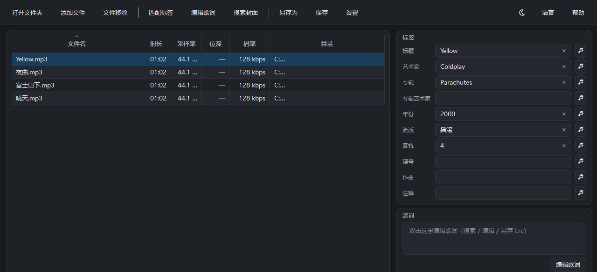

<div align="center">


<br>


# MusicTagStudio

**Windows 音乐标签批量编辑器 · 本地文件、纯离线、不传云端**


[下载安装](#下载安装) · [功能特性](#功能特性) · [界面预览](#界面预览) · [检测更新](#检测更新) · [更新日志](#更新日志) · [关于](#关于)

</div>

---

## 这是什么

MusicTagStudio 是一个**给自己用**的 Windows 桌面音乐标签工具：把一堆本地音频拖进来，批量改标题 / 艺术家 / 专辑 / 年份 / 流派 / 音轨，配封面、搜歌词、修编码，改完一次性写回文件。

全部用 PySide6 从零写出来：界面深色、操作直给、所有网络请求只走公开接口，**音乐文件只在你自己的硬盘上读写**，不上传任何内容。

---

## 功能特性

<table>
<tr>
<td width="140"><b>模块</b></td>
<td><b>能做什么</b></td>
</tr>
<tr>
<td><b>批量标签</b></td>
<td>多选文件统一写 标题 / 艺术家 / 专辑 / 专辑艺术家 / 年份 / 流派 / 音轨 / 碟号 / 作曲 / 注释；单行编辑 + 批量应用两种用法</td>
</tr>
<tr>
<td><b>标签匹配</b></td>
<td>按文件名或现有标签去公开音源检索，选一条结果回填全部字段；支持跨源（多条音源同时搜）</td>
</tr>
<tr>
<td><b>封面管理</b></td>
<td>网络搜索封面并预览、从文件里提取原封面、本地图片替换、一键删除封面、批量套用</td>
</tr>
<tr>
<td><b>歌词</b></td>
<td>在线搜索歌词、手动编辑、另存为 <code>.lrc</code>；<b>歌词编码修正</b>弹窗可逐个编码预览，双击即应用（UTF-8 / UTF-16 / UTF-16LE / UTF-16BE / BIG5 / GBK / ISO-8859-1 …）</td>
</tr>
<tr>
<td><b>安全回滚</b></td>
<td>每次保存前把原标签备份到 <code>MusicTagStudio_Data\undo</code>，随时撤销上一次写入</td>
</tr>
<tr>
<td><b>另存为</b></td>
<td>不改原文件，按新文件名另存一份（可顺带带封面 / 歌词）</td>
</tr>
<tr>
<td><b>文件管理</b></td>
<td>扫描文件夹（含子目录）、按格式过滤、移除条目、记住上次打开的目录</td>
</tr>
<tr>
<td><b>界面</b></td>
<td>深色 / 浅色主题、中文 / English 切换、列宽记忆、检测更新内置</td>
</tr>
</table>

支持格式按 mutagen 能力：`MP3` `FLAC` `M4A` `OGG` `OPUS` `WAV` `AIFF` `WMA` `APE` `MPC` `WV` `DSF` `DFF` `AAC` `TAK` `MP4`。

---

## 界面预览

<div align="center">



<sub>整窗全貌：左侧文件列表（文件名 / 标题 / 艺术家 / 专辑 / 封面 / 时长 / 目录），右侧标签编辑 → 歌词 → 封面预览三块可上下拖动分区</sub>

</div>

---

## 下载安装

到 **[Releases · v1.0](https://github.com/ZzicoChen/MusicTagStudio/releases/latest)** 下载，两种形式任选：

| 版本 | 文件 | 安装 / 使用 |
|---|---|---|
| **Windows 安装版** | `MusicTagStudio-Win-64-Setup-v1.0.exe` | 双击 → 选择安装目录 → 安装。自动建桌面 / 开始菜单快捷方式，写 HKCU 卸载项，可在「应用和功能」里卸载 |
| **Windows 便携版** | `MusicTagStudio-Win-64-Portable-v1.0.zip` | 解压到任意目录，双击 `MusicTagStudio.exe` 即用。整个文件夹要保留（`_internal` 不能单独删） |

两者程序内容完全一致，只是分发形式不同。全程不需要装 Python，依赖已打包。

### 数据放在哪

```
MusicTagStudio\                 ← 程序目录（安装版为安装时选的目录）
├─ MusicTagStudio.exe
├─ _internal\
└─ MusicTagStudio_Data\         ← 数据与缓存，跟着程序走
   ├─ settings.json             （你的设置）
   ├─ defaults.json             （出厂默认，可「保存当前设置为默认」覆盖）
   ├─ undo\                     （保存前的标签备份）
   └─ cache\                    （封面缩略图等缓存）
```

**把整个 `MusicTagStudio` 文件夹拷到 U 盘，设置和缓存一起跟着走**，换机器不用重配。只有程序目录不可写时（例如装进 `Program Files` 又没给权限）才回落到用户目录。

---

## 检测更新

工具栏「帮助」→ 弹窗里的「检测更新」。三路镜像依次尝试，任意一路通就能比对版本：

| 顺序 | 地址 | 用途 |
|---|---|---|
| 1 | `raw.githubusercontent.com/…/main/version.json` | 主地址 |
| 2 | `gh-proxy.com/https://raw.githubusercontent.com/…` | 国内直连不畅时的代理镜像 |
| 3 | `cdn.jsdelivr.net/gh/ZzicoChen/MusicTagStudio@main/version.json` | jsDelivr CDN 缓存 |

结果**直接显示在帮助页里**：已是最新 → 显示当前与远端版本、命中哪一路；有新版本 → 显示版本号、更新说明，并给「打开发布页下载」按钮；三路都失败 → 列出各路错误原因。也可以在设置里填自定义 `update_url` 顶掉默认地址。

想手动核对版本，看这里的 [`version.json`](version.json)。

---

## 更新日志

### v1.0 正式版（2026-11-26）

**界面**
- 「关于」与「检查新版本」合并成单一 **帮助页**（标题就叫「帮助」），检测更新结果原地显示，不再另开弹窗
- 关于页新增「作者：Zzico」与两张二维码：左 GitHub 首页、右 支持作者
- 主窗口 + 全部弹窗统一应用图标（旧绿色音符图标已全部替换）

**修复**
- 歌词编码修正弹窗：`UTF-16` / `UTF-16LE` / `UTF-16BE` / `BIG5` 等行字形上下错位、文字顶到行上沿的问题，现已逐行对齐
- 程序名与安装目录统一为 `MusicTagStudio`（此前中间带空格，导致目录名、exe 名不一致）

**功能**
- 新增检测更新：三路镜像兜底（见上节），`version.json` 驱动
- 数据目录与缓存目录收进程序文件夹（`MusicTagStudio_Data`），老版本放在上一级的数据会自动迁移配置

**打包**
- 资产命名规范：`MusicTagStudio-Win-64-Setup-v1.0.exe` / `MusicTagStudio-Win-64-Portable-v1.0.zip`

### 之前版本（开发期迭代，摘录）

- 批量标签编辑、标签匹配、跨源搜索、封面搜索 / 提取 / 替换 / 删除、歌词搜索与编辑、撤销备份、另存为、文件夹递归扫描
- 深色 / 浅色主题、中英切换、列宽与上次目录记忆、撤销记录管理
- 歌词编码修正弹窗、行内改名、文件移除等细节修复若干

---

## 常见问题

**Q. 提示「文件被占用 / 写入失败」？**
播放器（foobar2000、MusicBee 等）正打开该文件时会占用句柄，先关掉播放再保存。

**Q. 封面搜索没结果？**
换关键词（用「艺术家 + 专辑」比用歌名命中率高），或在设置里换一条封面源。

**Q. 想恢复出厂设置？**
删掉 `MusicTagStudio_Data\settings.json` 与 `defaults.json`，下次启动即是全新状态。

**Q. 检测更新一直失败？**
公司网络 / 代理拦截 `raw.githubusercontent.com` 时，会依次落到 gh-proxy 与 jsDelivr；三路全挂就是本机出网被卡，换网络或设置里的自定义 `update_url`。

---

## 关于

以下内容与软件内「帮助」弹窗一致（关于信息 + 检测更新合一，结果就地显示）。

<table>
<tr>
<td width="50%" valign="top">

**MusicTagStudio** `v1.0 正式版`

- 运行环境：Windows x64 · Python 3.13 + PySide6 · mutagen · 目录版
- 作者：**Zzico** · [GitHub](https://github.com/ZzicoChen)
- 数据目录：`MusicTagStudio_Data`（`settings.json` / `defaults.json` / 撤销备份）
- 缓存目录：`MusicTagStudio_Data\cache`（封面缩略图等）
- 全部保存在程序文件夹内，整个目录可搬移

</td>
<td width="50%" valign="top">

**检查更新**

点「检测更新」依次尝试三路镜像，结果直接显示在帮助页，不再另弹窗：

1. GitHub 直连 `raw.githubusercontent.com`
2. gh-proxy 镜像（国内连不上时的兜底）
3. jsDelivr CDN（缓存加速）

版本号来自本仓库 `version.json`，详情页指向 [Releases](https://github.com/ZzicoChen/MusicTagStudio/releases/latest)。

</td>
</tr>
</table>

<div align="center">

<table>
<tr>
<td align="center" width="50%"><br><sub>GitHub 首页</sub></td>
<td align="center" width="50%"><br><sub>支持作者</sub></td>
</tr>
</table>

**作者**：Zzico · [GitHub](https://github.com/ZzicoChen)

<sub>个人自用工具，按需取用；遇到 Bug 直接开 Issue。</sub>

</div>
